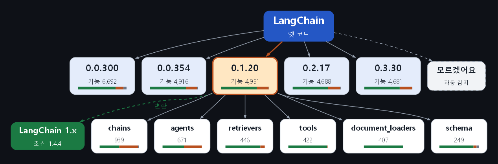

# 마이그레이션 챗봇 화면 (4번 · 화면)

> 팀 프로젝트 **LangChain 버전 마이그레이션 챗봇**의 화면을 먼저 만들어 보는 4번 작업 저장소입니다.
> 팀 저장소와 **같은 폴더 구조**로 만들어서, 완성되면 4번이 직접 팀 저장소의 4번 브랜치로 옮겨 PR합니다.
> 1 · 2 · 3번의 코드는 이 저장소에 넣지 않았습니다 (`src/agents`, `src/graph`, `src/rag`, `data`는 빈 자리).

## 화면 흐름

```text
① 시작: 버전 마인드맵 (LangChain → 옛 버전 → 영역)에서 옛 버전 고르기, 모르면 "자동 감지"
   → 고른 버전의 요약: 기능 수, 최신 위치로 이사 / 옛 창고(classic) / 못 찾음
② 목표 버전 확인: 지금은 1.x (현재 최신 langchain 1.4.4 · langchain-core 1.6.10 안내)
③ 채팅 + 결과 패널: 코드를 넣으면 "이 코드는 ○○ 시기 코드로 보여요"(자동 감지) 또는
   "고르신 버전과 다를 수 있어요"(단서와 함께) 안내 + 변환 결과
```



마인드맵은 graphviz로 그린 나무 구조입니다 (LangChain → 옛 버전 → 고른 버전의 영역, 옆에 목표 버전). **버전 상자를 클릭하면** 그 버전이 강조되고 가지가 펼쳐집니다 (위쪽 버전 버튼으로 골라도 됨). 클릭은 상자에 건 링크(`?v=버전`)로 받아서, 고른 뒤 주소에서 바로 지웁니다. 막대 색: 초록 = 1.x 최신 위치, 주황 = 옛 창고(classic), 회색 = 못 찾음.

옛 버전 목록(0.0.300 · 0.0.354 · 0.1.20 · 0.2.17 · 0.3.30)과 숫자는 2번 import 대응표를 센 요약(`src/ui/version_summary.json`)입니다. 자동 감지는 대응표의 "그 기능이 있던 버전"을 겹쳐 보는 방식이라 **범위**로 알려 줍니다. 팀 저장소에 `data/processed/import_map.jsonl`이 있으면 그것을 씁니다.

## 화면 구성: 채팅 + 결과 패널

| 위치 | 내용 |
|---|---|
| 사이드바 | 연결 상태 배지, 고른 버전(옛 → 목표)과 다시 고르기, 예제 버튼 4개, 대화 지우기 |
| 왼쪽: 채팅 | 옛 코드를 붙여 넣으면 진행 단계(①~⑤)가 차례로 보이고, 결과를 한 줄로 요약 |
| 오른쪽: 결과 패널 | 검증 배지 · 목표 버전 · 근거 출처 / 탭 3개: **전후 비교**, **변경표 · 근거**, **진행 과정** |
| 탭: 비교 (준비 중) | 일반 AI와 우리 챗봇의 비교 결과 자리 (챗봇 완성 후 평가로 채움) |
| 탭: 프로젝트 소개 | 발표 데모용 한 장 요약 (①~⑤와 담당 번호) |

## 지금 상태

| 부분 | 상태 |
|---|---|
| 화면 큰 틀 | ✅ 동작 |
| 변환 결과 | **가짜 결과** (`src/ui/mock.py`). 진짜 변환은 3번 몫 |
| 근거 | 팀 저장소에 2번 검색기(`src/rag/retrieval/import_lookup.py`)가 있으면 **실제 대응표 근거**(`imap-…`)를 자동으로 사용, 없으면 예시 근거(`sample-…`) |
| 챗봇 연결 | `src/ui/client.py`의 `run()` **한 곳만** 바꾸면 됨 (1번 그래프가 나온 뒤) |

## 실행

```bash
pip install -r requirements.txt
streamlit run app.py
```

팀 저장소에서는 1번과 상의한 뒤 `uv add streamlit` → `uv run streamlit run app.py`.

## 폴더 (팀 저장소와 같은 구조)

```text
├── app.py              ← 화면 (팀 저장소의 Hello World 자리)
├── src/
│   ├── ui/
│   │   ├── client.py   ← 챗봇을 부르는 단 한 곳 (지금은 가짜 결과)
│   │   ├── mock.py     ← 가짜 결과 + 2번 대응표 근거 찾기
│   │   ├── versions.py ← 버전 요약 · 자동 감지
│   │   ├── mindmap.py  ← 시작 화면 마인드맵 (graphviz)
│   │   └── version_summary.json ← 2번 대응표의 버전 · 영역별 숫자 요약
│   ├── agents/  graph/  prompt/  rag/   (빈 자리: 1 · 2 · 3번 몫)
├── data/               (빈 자리: 2번 몫)
└── docs/
    └── 화면_결과_모양.md  ← 화면이 받고 싶은 결과 모양 (1 · 3번과 상의할 초안)
```

## 팀 저장소로 옮길 때

1. 1번에게 `app.py` 자리와 `streamlit` 추가를 확인받기
2. 팀 저장소 4번 브랜치에 `app.py`, `src/ui/`, `docs/화면_결과_모양.md`만 복사 (빈 자리 폴더는 복사하지 않음)
3. 화면을 켜서 근거 배지가 **"근거: 2번 대응표"**로 바뀌는지 확인 → PR
